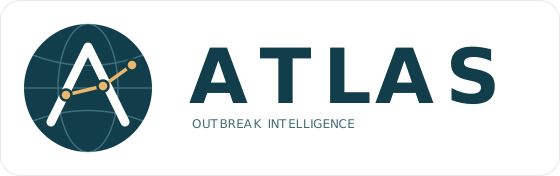
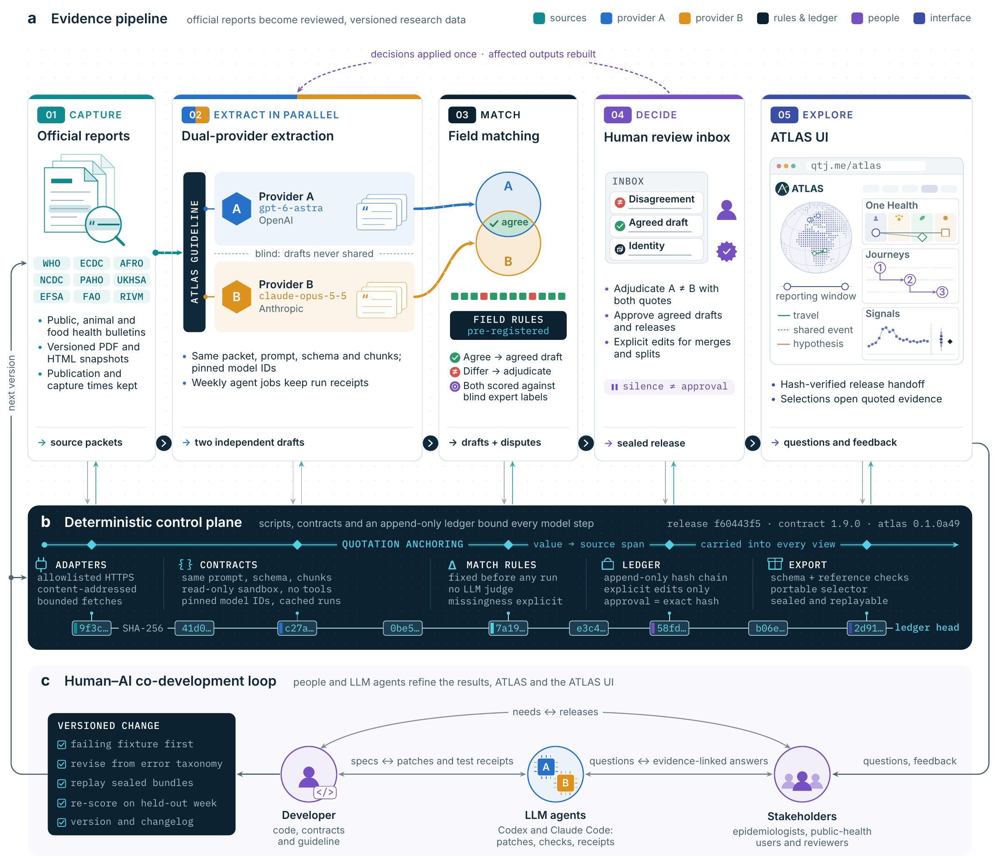

<h1></h1>

**Agentic Tracking and Longitudinal Analysis for Surveillance**

One Health outbreak intelligence across sources, places, and time.


[](https://github.com/EvoLandEco/ATLAS/actions/workflows/ci.yml)
[](LICENSE)

ATLAS helps researchers follow outbreak and surveillance reporting across human, animal, environmental and food health. It gathers publications from multiple sources and turns their findings into material for scientific review and analysis.

Readers can trace findings to the original reports, explore how a situation develops over time, and examine connections between places and hosts. Outbreak identities, epidemiological relationships and publication decisions require human review.

[Explore ATLAS](https://qtj.me/atlas/)

## Capabilities

- **Follow developments.** Weekly briefings and daily Trends summarize recent reports and highlight questions worth investigating.
- **Examine the evidence.** Source passages accompany each finding, together with dates, locations and explanations of what is uncertain or missing.
- **Compare observations.** Numerical series and geographic views draw on assessed comparisons, including evidence of travel, exposure and transmission. Reporting periods, case definitions and sampling methods help readers judge what can be compared.
- **Work with the data.** Export datasets for analysis and visualization, with source references and documented selection rules. Archived reports can be reproduced from their saved inputs.

## Workflow

[](docs/figures/atlas-workflow-figure.pdf)

Dual-provider extraction is being tested. [Download the workflow figure](docs/figures/atlas-workflow-figure.pdf).

## Sources

The collection covers 17 source profiles from international agencies, national surveillance bodies and news outlets.

| Group | Sources |
| --- | --- |
| WHO | Disease Outbreak News; WHO Africa outbreak bulletins; emergency situation updates |
| Regional and international | ECDC Communicable Disease Threats Reports; PAHO alerts and updates; UN Geneva public health briefings |
| National | Nigeria NCDC; UKHSA; RIVM; Santé publique France; Robert Koch Institute; China CDC; US CDC MMWR |
| Animal and food health | EFSA; FAO avian influenza situation updates |
| News | CBS News Health; IRK.ru |

Coverage varies by source, reporting period and access conditions. See the [source catalog](docs/SOURCES.md) for details.

## Quick start

Use Python 3.11 or later and Node.js 20 or later with npm. From the repository root:

```bash
bash scripts/install.sh
source .venv/bin/activate
atlas init
atlas doctor
atlas demo --out demo-output
```

The demo uses synthetic evidence and requires an empty output directory. See [Operations](docs/OPERATIONS.md) for collection, extraction and report generation.

## Documentation

- [Data semantics](docs/DATA_SEMANTICS.md): observations, dates, missing values and comparison rules.
- [Scientific review](docs/EDITORIAL_GUIDE.md): evidence assessment and outbreak identity.
- [Structured exports](docs/SITE_EXPORT.md): datasets, provenance and analytical selection.
- [Evaluation](docs/EVALUATION.md): fixtures, benchmarks and validation.
- [Contributing](CONTRIBUTING.md): development and contributions.

ATLAS is an experimental research release under the [MIT license](LICENSE). Source reuse and redistribution follow the publisher's terms.
